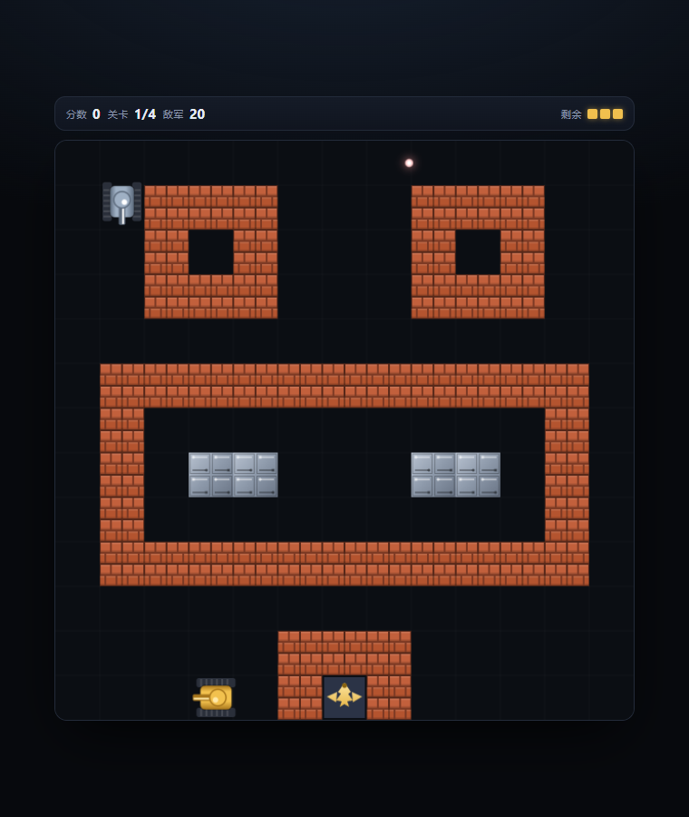

# 坦克大战 · Tank Battle

一个用纯 HTML5 Canvas 写的经典坦克大战（Battle City）小游戏。

**零依赖、零构建、单个文件** —— 双击 `index.html` 就能玩。



## 玩法

保护屏幕底部的基地（老鹰 ⛨），消灭每一关的全部敌军坦克。
基地被摧毁，或者生命耗尽，游戏结束。

## 操作

| 按键 | 功能 |
| --- | --- |
| `↑` `↓` `←` `→` 或 `W` `A` `S` `D` | 移动 |
| `空格` 或 `J` / `K` | 开火 |
| `P` / `Esc` | 暂停 |
| `R` | 重新开始 |
| `M` | 静音 |

手机 / 平板会自动显示屏幕方向键和开火按钮。

## 特性

- **4 张手工设计的地图**，每关敌军编成不同，难度递增
- **4 种敌军坦克**：普通、快速、强化火力、重装甲（需多次击毁）
- **6 种道具**：★ 火力提升、💥 全屏清敌、⛑ 无敌护盾、⛏ 基地加固、⏱ 时间冻结、🚚 额外生命
- **可破坏的砖墙**：每块砖分成 2×2 子块，逐块击碎，可以给自己打出一条通路
- **钢墙**：普通子弹打不穿，火力升到满级才能击毁
- **河流**：挡住坦克但子弹可以飞过；**树林**：坦克可以藏进去，敌人看不见你
- **音效**：全部用 Web Audio API 实时合成，不加载任何音频文件
- 最高分本地保存（localStorage）
- 响应式布局，支持键盘与触屏，自适应高分屏

## 运行

直接用浏览器打开：

```bash
# 方式一：双击 index.html

# 方式二：起个本地服务器
python -m http.server 8000
# 然后访问 http://localhost:8000
```

## 部署到 GitHub Pages

仓库设置 → Pages → Source 选 `Deploy from a branch`，分支选 `main`、目录选 `/ (root)`，
保存后即可通过 `https://<用户名>.github.io/<仓库名>/` 访问。

## 技术说明

整个游戏是一个自包含的 `index.html`，没有外部依赖、没有构建步骤，代码结构大致是：

| 模块 | 说明 |
| --- | --- |
| 常量与地图 | 13×13 格，每格 48px；地图用 ASCII 字符串描述 |
| 碰撞 | AABB；坦克与地形/基地/其他坦克，子弹分步推进防止高速穿墙 |
| 砖墙 | 每格 4 位掩码记录 2×2 子块的存活状态 |
| 敌军 AI | 定时重新决策，有概率朝基地或玩家推进，对准目标时开火 |
| 渲染 | 砖/钢/水贴图预渲染到离屏 canvas，避免每帧创建上千个渐变 |
| 音效 | Web Audio 振荡器 + 噪声缓冲实时合成 |

## 许可

未指定许可证。如需开源，可在仓库中添加 `LICENSE` 文件（例如 MIT）。
